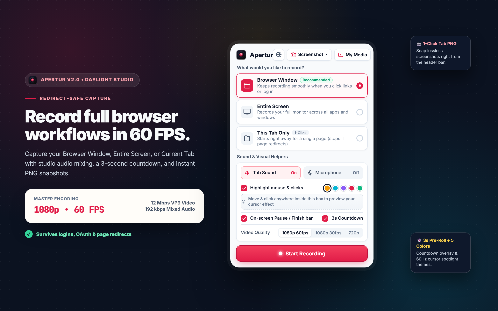
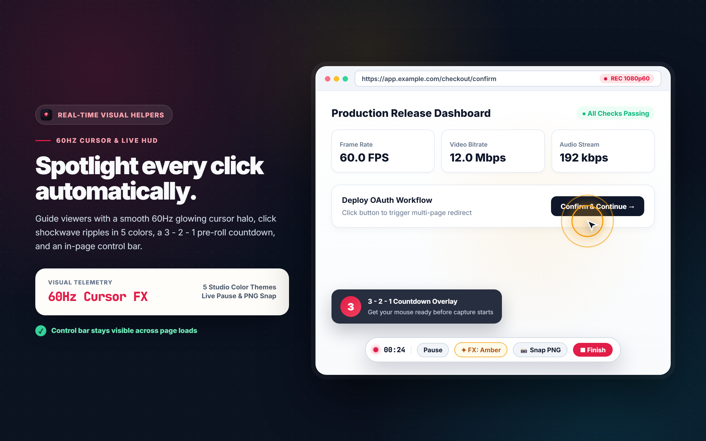
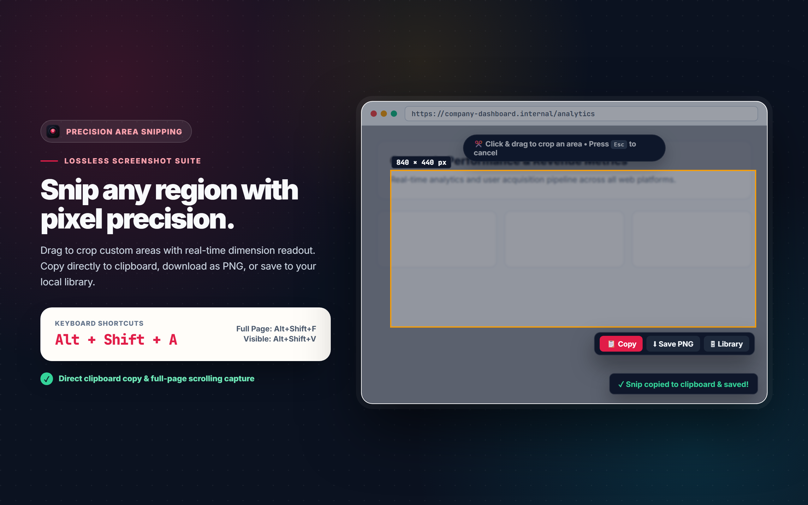
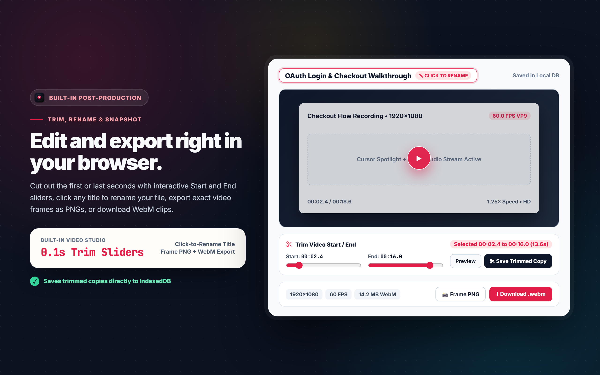
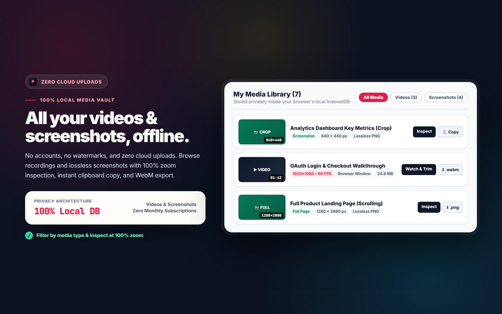

<div align="center">
  
  <h1>Apertur</h1>
  <p><strong>Free, Open-Source 1080p 60 FPS Screen Recorder &amp; Lossless Screenshot Suite for Chrome</strong></p>

  <p>
    <a href="https://github.com/tahsinsoyak/apertur/blob/main/LICENSE"></a>
    &nbsp;
    <a href="manifest.json"></a>
    &nbsp;
    <a href="https://www.patreon.com/tahsinsoyak"></a>
    &nbsp;
    <a href="https://github.com/tahsinsoyak/apertur/releases/latest"></a>
  </p>

  <p>
    <a href="https://tahsinsoyak.github.io/apertur/"><strong>🌐 Live Interactive Demo &amp; Landing Page</strong></a>
    &nbsp;•&nbsp;
    <a href="docs/USER_GUIDE.md"><strong>📖 Complete User Guide</strong></a>
    &nbsp;•&nbsp;
    <a href="PRIVACY.md"><strong>🔒 Privacy Policy</strong></a>
    &nbsp;•&nbsp;
    <a href="https://github.com/tahsinsoyak/apertur/releases/latest"><strong>📦 Download Extension v2.1 (.zip)</strong></a>
    &nbsp;•&nbsp;
    <a href="https://tahsinsoyak.github.io/apertur/sponsor.html"><strong>💖 Sponsor &amp; Patreon</strong></a>
    &nbsp;•&nbsp;
    <a href="SPONSORS.md"><strong>🌟 Backer Tiers</strong></a>
    &nbsp;•&nbsp;
    <a href="https://github.com/tahsinsoyak/apertur/issues"><strong>🐛 Report Issue</strong></a>
  </p>
</div>

---

## 📸 Visual Showcase

<div align="center">
  
</div>

<br/>

<table align="center" width="100%">
  <tr>
    <td width="50%">
      
      <p align="center"><strong>Live 60 FPS Recording + Floating HUD &amp; Cursor Spotlight</strong></p>
    </td>
    <td width="50%">
      
      <p align="center"><strong>Precision Area Crop (<kbd>Alt+Shift+A</kbd>) with Live Dimensions</strong></p>
    </td>
  </tr>
  <tr>
    <td width="50%">
      
      <p align="center"><strong>Video Player Studio with Start/End Trim Sliders &amp; Rename</strong></p>
    </td>
    <td width="50%">
      
      <p align="center"><strong>Unified Media Library (Videos &amp; Screenshots) + 100% Zoom Viewer</strong></p>
    </td>
  </tr>
</table>

---

## ✨ Features at a Glance

Apertur is a 100% free, private alternative to cloud screen recorders like Loom. All encoding and storage run locally in your browser with zero monthly fees, zero watermarks, and no cloud surveillance.

| Feature | Description |
| :--- | :--- |
| **🎬 1080p 60 FPS Engine** | Hardware-accelerated VP9 encoding up to 12 Mbps with 192 kbps dual-channel audio |
| **🛡️ Redirect-Safe** | Window capture survives multi-page logins, OAuth redirects, and full workflows |
| **🎯 Cursor Spotlight** | 60Hz cursor halo & expanding click shockwaves in 5 studio colors |
| **🎙️ Pro Mic Setup** | Live audio VU level meter, input device selector, and 50%–200% boost gain slider |
| **⏱️ 3-Second Countdown** | Optional 3, 2, 1 pre-roll overlay so your cursor is ready before recording starts |
| **✂️ Built-in Video Trimmer** | Drag Start and End sliders to cut dead time and save trimmed clips instantly |
| **📦 Export Presets** | 1-click export: 1080p Master, 720p Web-Ready, Audio-Only, or 5s Looping WebM |
| **🎨 Annotation Studio** | Mark up screenshots with Pen, Arrows, Boxes, Highlighter, and Text badges |
| **📸 3-Way Screenshots** | Area Crop (<kbd>Alt+Shift+A</kbd>), Full Webpage (<kbd>Alt+Shift+F</kbd>), and Visible Viewport (<kbd>Alt+Shift+V</kbd>) |
| **🔒 100% Private Vault** | Offline IndexedDB storage with full-resolution zoom viewer and instant WebM downloads |

📖 For step-by-step instructions and tips, see the **[Complete User Guide](docs/USER_GUIDE.md)** or **[60-Second Cheat Sheet](USAGE.md)**.

---

## ⌨️ Global Keyboard Shortcuts

| Shortcut | Action | Description |
| :--- | :--- | :--- |
| <kbd>Alt</kbd> + <kbd>Shift</kbd> + <kbd>A</kbd> | **Area Crop (Snip)** | Click &amp; drag to crop any region with live dimensions and floating toolbar |
| <kbd>Alt</kbd> + <kbd>Shift</kbd> + <kbd>F</kbd> | **Full Webpage** | Automatically scrolls and stitches the entire full page into a lossless PNG |
| <kbd>Alt</kbd> + <kbd>Shift</kbd> + <kbd>V</kbd> | **Visible Area** | 1-click capture of the currently visible viewport |

---

## 🚀 Installation & Quick Start

### Option A: Instant Release Download (No Terminal Required)
1. Download **[`apertur-v2.1.0-chrome-extension.zip`](https://github.com/tahsinsoyak/apertur/releases/latest)** from the latest GitHub Release and extract the ZIP.
2. Open Chrome (or Brave, Edge, Arc) and navigate to `chrome://extensions/`.
3. Enable **Developer mode** using the toggle switch in the top-right corner.
4. Click **Load unpacked** and select the extracted folder.

### Option B: Build from Source
```bash
# 1. Clone repository
git clone https://github.com/tahsinsoyak/apertur.git
cd apertur

# 2. Build production package into dist/
npm run build

# 3. (Optional) Create Chrome Web Store production ZIP
npm run package
```
Then open `chrome://extensions/`, enable **Developer mode**, click **Load unpacked**, and select the generated **`dist/`** directory.

---

## 🔒 100% Private Architecture

Apertur is designed with a strict zero-knowledge, local-only architecture:

- **Local Storage Only**: All recordings and screenshots are saved directly inside your browser's local IndexedDB vault.
- **Zero Cloud Uploads**: No video, audio, or screenshot frames are ever transmitted over the network.
- **No Remote Code & No Trackers**: Zero third-party analytics, zero telemetry SDKs, and zero tracking pixels.
- **On-Demand Injection**: Scripts are only injected when you actively record or trigger a screenshot, keeping regular browsing completely untouched.

For details, read our complete **[Privacy Policy](PRIVACY.md)** (or view the [Live Privacy Policy](https://tahsinsoyak.github.io/apertur/privacy.html)).

---

## 🏬 Chrome Web Store Publishing

Everything is pre-configured and ready for one-click submission to the Chrome Web Store:

- **Manifest V3 Compliant**: Uses minimal required permissions (`tabCapture`, `offscreen`, `activeTab`, `storage`, `scripting`, `clipboardWrite`).
- **Store-Ready Graphics**: 1280x800 showcase screenshots, 440x280 small promo tile, and 1400x560 marquee promo tile in [`store-assets/chrome-web-store/`](store-assets/chrome-web-store/).
- **Step-by-Step Copy/Paste Guide**: See **[`store-assets/STORE_LISTING.md`](store-assets/STORE_LISTING.md)** for exact descriptions, category settings, and permission justifications ready to paste into the Google Developer Console.
- **Automated Packager**: Run `npm run package` to compile and produce a validated ZIP in `release/`.

---

## 🤝 Contributing & Community

Contributions are welcome! Please check our community guidelines:

- **[Contributing Guide](CONTRIBUTING.md)**: How to set up local dev, make changes, and open PRs.
- **[Code of Conduct](CODE_OF_CONDUCT.md)**: Our pledge to maintain a welcoming and inclusive community.
- **[Security Policy](SECURITY.md)**: How to responsibly disclose any security concerns.
- **[Changelog](CHANGELOG.md)**: Release history and version notes.
- **[Discussions](https://github.com/tahsinsoyak/apertur/discussions)**: Community questions, feature ideas, and workflows.

## 🎥 Three Recording Modes

| Mode | Best For | Survives Page Redirects? | Audio Support |
| :--- | :--- | :--- | :--- |
| **Browser Window (`Recommended`)** | Multi-page workflows, SaaS testing, OAuth logins | ✅ **Yes (100% Continuous)** | System/Tab Audio + Mic |
| **Entire Screen** | Multi-window demos, IDE + terminal + browser workflows | ✅ **Yes (100% Continuous)** | System Audio + Mic |
| **This Tab Only (`1-Click`)** | Quick single-page clips without a picker dialog | ⚠️ Stops if tab navigates | Tab Audio (Unmuted) + Mic |

---

## 🧪 Testing & Verification

Apertur includes automated headless and live browser verification suites powered by Playwright and Chromium:

```bash
# 1. Run static integrity assertions
node scripts/test-screenshots.js

# 2. Verify popup dimensions, zero-scroll bounds & gallery
node scripts/verify-all.js

# 3. Run live end-to-end browser tests (Area crop, full page scroll, modal zoom & DB)
node scripts/test-live-e2e.js

# 4. Regenerate all 1280x800 showcase screenshots
node scripts/capture-store-screenshots.js
```

---

## 💖 Support the Developer & Sponsor Apertur

Apertur is built and maintained as a completely free, open-source project by **[Tahsin Soyak](https://github.com/tahsinsoyak)** under the MIT license.

There are zero cloud subscriptions, zero paywalls, and zero watermarks. If Apertur has saved you or your team from paying $15 to $29 per month for proprietary screen recorders, please consider supporting ongoing development:

[](https://www.patreon.com/tahsinsoyak)

- **Patreon**: [patreon.com/tahsinsoyak](https://www.patreon.com/tahsinsoyak)
- **Dedicated Sponsor Page**: [Online Sponsor Page](https://tahsinsoyak.github.io/apertur/sponsor.html)
- **Sponsorship Guide & Roadmap**: [SPONSORS.md](SPONSORS.md)
- **GitHub Star**: [github.com/tahsinsoyak/apertur](https://github.com/tahsinsoyak/apertur)

### Patreon Membership Tiers

| Tier | Monthly Contribution | Highlights |
| :--- | :--- | :--- |
| ☕ **Coffee Supporter** | **$3 / month** | Shoutout in GitHub Release notes and eternal gratitude |
| 🚀 **Studio Backer** | **$10 / month** | Name listed in README & Website wall + Early access to feature builds |
| 💎 **Visionary Sponsor** | **$25 / month** | Logo & backlink on README/Website + Priority feature/bug triage |

Your contributions fund Chrome Web Store maintenance, WebCodecs and AV1 video research, webcam Picture-in-Picture overlays, and continuous open-source innovation.

---

## 📄 License

Released under the **[MIT License](LICENSE)**. 100% free forever for personal, educational, and commercial use.
